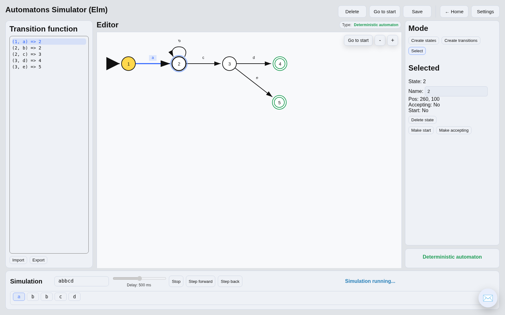
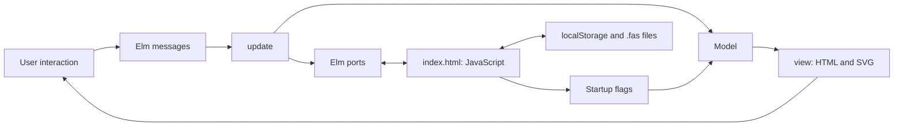

<h1 align="center">Finite Automata · Elm</h1>

<p align="center">
  <strong>An interactive simulator for learning automata theory.</strong>
</p>

<p align="center">
  Build state graphs, edit transition functions, and explore execution step by step in your browser.
</p>

<p align="center">
  <a href="https://gh0st3r0k.github.io/Simulator-FA/#/">Live demo</a> ·
  <a href="#overview">Overview</a> ·
  <a href="#getting-started">Getting started</a> ·
  <a href="#user-guide">User guide</a> ·
  <a href="#development">Development</a> ·
  <a href="#bachelors-thesis">Bachelor’s thesis</a>
</p>

<p align="center">
  <a href="https://elm-lang.org/"></a>
  <a href="index.html"></a>
  <a href="#bachelors-thesis"></a>
  <a href="LICENSE"></a>
</p>

---

## Overview

This is the practical implementation of a **bachelor’s thesis at FIIT STU**, built with **Elm 0.19.1**, HTML, CSS, and JavaScript. It runs entirely in the browser and can be deployed as static files.

| Feature | What you can do |
| --- | --- |
| Graph editor | Draw and edit states and transitions; mark start and accepting states; pan and zoom. |
| Transition function | Import and export textual transitions, with validation feedback. |
| Simulation | Run automatically or step forward and backward through the current state and input. |
| Nondeterminism | Inspect the reasons for nondeterminism and choose between candidate transitions. |
| Save slots | Store models locally and share them as `.fas` files. |
| Examples | Explore built-in deterministic and nondeterministic finite automata. |
| Settings | Choose one of four interface languages, a light or dark theme, and a start page. |

The finite automaton editor is the main result of the thesis. The application also includes **experimental pushdown automaton and Turing machine editors**, with stack or tape operations and their own simulation logic. See [limitations](#limitations) before using these extensions.



*The built-in deterministic example after its first simulation step. The active transition and consumed input symbol are highlighted together.*

## Getting started

The repository includes a compiled `main.js`, so Elm and Node.js are **not required to try the application**. With Git and Python 3 installed:

```bash
git clone https://github.com/Gh0st3r0k/Simulator-FA.git
cd Simulator-FA
python3 -m http.server 8000
```

Open `http://localhost:8000/` in a modern browser. On the first visit, choose your language, theme, and start page, then select **Continue**. Stop the server with `Ctrl+C`.

Any static HTTP server can be used instead of Python. Serve the project root so that `index.html`, `main.js`, `icon.png`, `version.json`, and `changelog.json` remain available together.

To rebuild the application or work on the Elm source, continue with [Development](#development).

## User guide

### Example walkthrough

1. Open **Examples → Deterministic finite automaton**.
2. Enter `abbcd` in the **Simulation** input field.
3. Select **Start step-by-step simulation**, then **Step forward** to follow the graph. **Step back** restores the previous simulation state.
4. Follow the path `1 → 2 → 2 → 2 → 3 → 4`. State `4` is accepting; after the final symbol, the application displays **Success**.
5. Use **Start simulation** for an automatic run. If a simulation session is still active, select **Stop** before changing the input or starting another run.

The deterministic example recognizes words of the form `ab*c(d|e)`: one `a`, zero or more `b` symbols, one `c`, and a final `d` or `e`.

| Input | Expected result |
| --- | --- |
| `acd` | Success: ends in accepting state `4`. |
| `abbbce` | Success: ends in accepting state `5`. |
| `ac` | Rejected: input ends in non-accepting state `3`. |
| `ax` | Dead end: no transition matches `x` from state `2`. |

For a branching example, open **Examples → Non-deterministic finite automaton** and try `aba`. Both outgoing transitions from the start state match `a`; choose a branch and inspect how that choice affects the rest of the run.

### Graph editor controls

| Action | Control |
| --- | --- |
| Add a state | Select **Create states**, then click empty canvas space. |
| Add a transition | Select **Create transitions**, click the source state, then the destination. Use the same state twice for a self-loop. |
| Edit an object | Select **Select**, then click a state or transition and use its fields in the side panel. |
| Move a state | Drag it in **Select** mode. |
| Set the start state | Select a state, then choose **Make start**. |
| Toggle acceptance | Double-click a state or use its accepting-state control. |
| Pan and zoom | Drag with the middle mouse button or scroll to pan; use `+` and `−` to zoom. |
| Find the start state | Select **Go to start**. |

### Transition syntax

In the finite automaton editor, each nonempty line describes one transition:

```text
(q0, a) => q1
(q1, b) => q1
(q1, c) => q2
(q2, λ) => q3
```

State names must not contain spaces; each condition is one character. `λ` denotes a transition that consumes no input symbol.

**Import** applies this text to the graph. **Export** generates text from the current graph. Newly introduced states need their accepting flags set in the canvas; the transition-function syntax does not encode accepting states, coordinates, or the complete saved model. Use `.fas` for a full model export.

### Keyboard shortcuts

Shortcuts apply while focus is outside editable fields.

| Shortcut | Action |
| --- | --- |
| `Alt+1` / `Alt+2` / `Alt+3` | Create states / create transitions / select and move. |
| `Alt+S` | Toggle the selected state’s start flag. |
| `Alt+E` | Toggle the selected state’s accepting flag. |
| `Alt+N` | Focus the selected object’s name or label field. |
| `Alt+Q` | Center the canvas on the start state. |
| `Alt+T` | Focus the transition-function editor. |
| `Shift+Alt+S` | Focus the simulation input. |
| `Shift+Alt+Enter` | Start or stop simulation. |
| `Shift+Alt+N` | Show or hide automaton-type details. |
| `Delete` / `Cmd+Backspace` on macOS | Delete the selected state or transition. |

### Saving and sharing

Open **Save** and save the current model to a slot. Slots are stored in the browser’s `localStorage`, along with language, theme, and start-page preferences. Editing the canvas is not a substitute for saving the model to a slot.

Saved data belongs to a browser profile and origin. Another browser, a different port, private browsing, or cleared site data will not share those saves. Export important models as `.fas` files to move them between devices or keep a backup.

In the **Save** dialog, select **Save current** in a slot, then use **Export .fas** to download its model. To restore a file, use a slot’s **Import .fas** action, select the file, and then load that slot into the editor.

## Development

### Requirements

Install **Elm 0.19.1** using the [official installation guide](https://guide.elm-lang.org/install/elm.html). If Node.js and npm are available, a pinned compiler can also be installed with:

```bash
npm install --global elm@0.19.1-6
elm --version
```

The expected compiler version is `0.19.1`.

### Build from source

From the repository root, compile and serve the application:

```bash
elm make src/Main.elm --optimize --output=main.js
python3 -m http.server 8000
```

Elm installs the exact dependency versions declared in [`elm.json`](elm.json). The first build needs access to the Elm package registry and package sources. No project-level `npm install`, environment variables, API keys, database, or backend service is needed.

`main.js` is tracked: rebuilding it updates the included browser bundle. Keep the compiled bundle in sync with source changes when preparing a release.

### Development workflow

After editing an Elm module, rerun `elm make` and refresh the browser. The command above creates an optimized build; omit `--optimize` for a development build, or use `--debug` for the Elm debugger.

Elm Reactor is also available:

```bash
elm reactor
```

Reactor normally serves on port `8000`. It is useful for Elm compilation and browsing the project, but opening `src/Main.elm` directly does not use the custom JavaScript integration in `index.html`. For the complete application, including startup flags, persistent settings, and file import/export, compile `main.js` and serve `index.html` as shown above.

### Architecture

The application follows **The Elm Architecture (Model–View–Update)**. Elm manages application state, graph editing, simulation, routing, and rendering. A small JavaScript integration layer supplies browser APIs through startup flags and ports.



### Project structure

| File | Responsibility |
| --- | --- |
| [`src/Main.elm`](src/Main.elm) | Application shell, page updates, settings, shared save slots, built-in examples, and ports. |
| [`src/Route.elm`](src/Route.elm) | Hash-based routing between menus, editors, instructions, and the About page. |
| [`src/Pages/Editor.elm`](src/Pages/Editor.elm) | Finite automaton model, SVG editor, transition syntax, simulation, and serialization. |
| [`src/Pages/EditorStack.elm`](src/Pages/EditorStack.elm) | Experimental pushdown automaton editor and stack simulation. |
| [`src/Pages/EditorTuring.elm`](src/Pages/EditorTuring.elm) | Experimental Turing machine editor and tape simulation. |
| [`src/AutomatonFormat.elm`](src/AutomatonFormat.elm) | Shared `.fas` document wrapper and automaton-type encoding. |
| [`src/I18n.elm`](src/I18n.elm), [`src/Theme.elm`](src/Theme.elm), [`src/Design.elm`](src/Design.elm) | Translations, theme colors, and interface design tokens. |
| [`index.html`](index.html) | Elm initialization, local storage, file import/export, and update checks. |
| [`main.js`](main.js) | Compiled Elm application loaded by `index.html`. |
| [`version.json`](version.json), [`changelog.json`](changelog.json) | Release metadata and localized update notes. |

### File format

`.fas` files contain JSON. The current encoder wraps the graph in this document structure:

```json
{
  "format": "fas",
  "version": 2,
  "automatonType": 1,
  "automaton": {
    "states": [],
    "transitions": []
  }
}
```

Type `1` identifies a finite automaton; type `2` identifies a stack automaton. States carry IDs, names, coordinates, and start/accepting flags. Transitions refer to state IDs and carry labels. The decoder also accepts the older, unwrapped graph structure. Serialization and type handling live in [`src/AutomatonFormat.elm`](src/AutomatonFormat.elm).

### Manual validation

The repository currently has no automated test suite or CI workflow. A successful Elm build checks compilation and types; functional behavior should also be checked in the browser.

Before submitting or publishing a change:

1. Build `src/Main.elm` with Elm `0.19.1` and serve the resulting bundle through `index.html`.
2. Run the deterministic example with the four inputs and expected results listed above. Verify forward and backward stepping, then repeat a successful input in automatic mode.
3. Open the nondeterministic example and confirm that an ambiguous step offers a transition choice.
4. Create a graph, save it to a slot, reload the page, and load the slot. Export it as `.fas`, import it into another slot, and check that states, labels, and flags survive.
5. Check all three editors, Instructions, and About; switch language and theme; inspect the browser console for errors.

### Deployment

Build `main.js`, then publish these files together to a static host such as GitHub Pages:

```text
index.html
main.js
icon.png
version.json
changelog.json
```

Routes use URL fragments such as `#/editor`, so internal navigation does not require server-side route rewrites. No server-side compilation or application backend is required after deployment.

## Bachelor's thesis

| Field | Details |
| --- | --- |
| Author | Kostiantyn Zaitsev |
| Institution | Slovak University of Technology in Bratislava, Faculty of Informatics and Information Technologies |
| Study programme | Informatics |
| Thesis title | *Realizácia simulátora konečného automatu v jazyku Elm* |
| Supervisor | Ing. Ivan Kapustík |
| Year | 2026 |

The thesis title translates as *Implementation of a Finite Automaton Simulator in Elm*. The work was carried out at the Faculty of Informatics and Information Technologies, Slovak University of Technology in Bratislava.

The project supports teaching and experimentation in automata theory and formal languages, particularly the course *Teoretické základy informatických vied*. Its central aim is to make execution visible: learners can connect a formal transition function with changes in the graph and input position.

| Thesis objective | Corresponding implementation |
| --- | --- |
| Implement an interactive simulator in Elm | Browser application with typed models and Model–View–Update. |
| Design a usable visual interface | SVG graph editing, object properties, textual transitions, and localized instructions. |
| Support independent and stepwise execution | Automatic execution and forward/backward stepping with visual feedback. |
| Save and load models | Browser-local slots and portable `.fas` documents. |
| Explore modular application design | Separate page modules and shared routing, serialization, localization, and styling. |
| Evaluate the solution and compare existing tools | Discussed in the written thesis; the repository does not contain an automated reproduction of those evaluations. |

Pushdown and Turing machine support explore how the original editor can be extended to other computational models. The Turing module is explicitly marked as generated with Codex assistance; this experiment is supplementary to the finite automaton work.

## Limitations

- **Nondeterministic execution follows a selected path.** The simulator offers manual choices between candidate transitions; it does not explore all branches automatically. A failed chosen path does not prove that an NFA rejects the word.
- **λ handling is specific to this implementation.** In the finite simulator, matching input-consuming transitions take priority; λ-transitions are considered when none match. This is not a general ε-closure algorithm.
- **Experimental editors need separate evaluation.** The Turing editor currently reuses the stack automaton’s `.fas` type tag, so files do not have a distinct Turing-machine identifier.
- **Storage is local.** There are no accounts, cloud synchronization, or collaborative sessions. Keep exported backups of important models.
- **Performance depends on the graph and device.** Large graphs and long or cyclic runs can reduce responsiveness; the repository does not provide a performance benchmark suite.

## Troubleshooting

| Problem | What to check |
| --- | --- |
| The interface looks outdated after a deployment | Hard-refresh the page with `Ctrl+F5` or the browser’s equivalent. |
| Elm cannot download dependencies | Check network access to `package.elm-lang.org` and the package source hosts. |
| Import, export, or persistence is unavailable | Run the complete application through `index.html` and make sure browser storage is available. |

## Feedback

For a bug report, include the browser, editor type, steps to reproduce, and a small example or `.fas` file. Reports can be filed through [GitHub Issues](https://github.com/Gh0st3r0k/Simulator-FA/issues). The application also includes a feedback dialog; review its prefilled diagnostic information before sending.

## License

This project is distributed under the [MIT License](LICENSE). Copyright © 2026 Kostiantyn Zaitsev.
